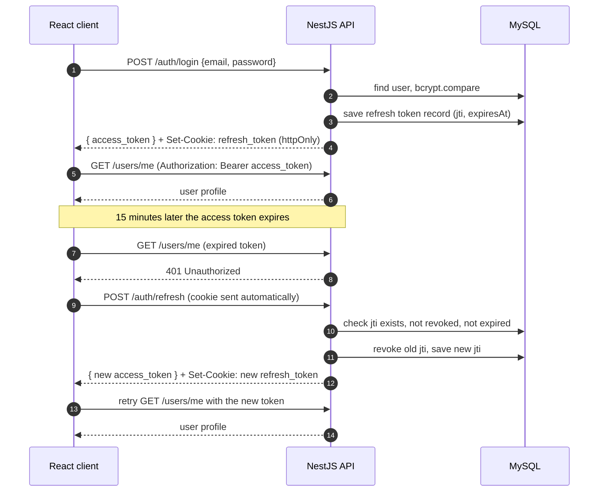

# Auth System

A full stack **JWT authentication** reference project: a **NestJS** API with short-lived access tokens, **rotating refresh tokens** stored in the database, and a **React** client that keeps users signed in silently.


## Features

- **Register and log in** with email and password (hashed with **bcrypt**)
- **Access token** (JWT, 15 min) sent as a `Bearer` header and kept **in memory** on the client, never in `localStorage`
- **Refresh token** (JWT, 7 days) in an **`httpOnly`, `sameSite=strict` cookie** that is only sent to `/auth/refresh`, so page scripts can't read it
- **Refresh token rotation**: every refresh revokes the old token and issues a new one. Each token is tracked in the DB by its `jti`, so it can be revoked server-side.
- **Silent session restore**: on page load the client calls `/auth/refresh` to sign the user back in
- **Automatic retry**: an Axios interceptor catches a `401`, refreshes the token once and replays the original request
- **Logout** revokes all of the user's refresh tokens and clears the cookie
- **Protected routes** on both sides: a Passport `JwtAuthGuard` on the API and a `ProtectedRoute` component on the client
- **Validated configuration**: the API refuses to start if a secret is missing, shorter than 32 characters, or reused for both token types
- **Input validation**: DTOs reject bad input and unknown fields with clear `400` messages. Passwords need 8–72 characters with mixed case and a number, and emails are normalized (trimmed and lowercased).
- **Password hashes never leave the server**: not loaded by default, and stripped from every response
- **No account enumeration by timing**: login takes the same time whether or not the email exists
- **`409 Conflict` for duplicate emails**, safe under concurrent sign-ups
- **Consistent errors**: every error is `{ statusCode, error, message, path, timestamp }`, and internal details are never exposed
- **Role-based access control**: `user` and `admin` roles carried in the access token, with a `@Roles()` decorator and `RolesGuard` (`403` for other roles)
- **Rate limiting** per IP on every route, with a much stricter limit on login and sign-up against password guessing (`429`)
- **Security headers** with `helmet`
- **End-to-end tests** for the full auth flow, running against an in-memory database

## How it works



### Why two tokens?
| | Access token | Refresh token |
|---|---|---|
| Lifetime | 15 minutes | 7 days |
| Where it lives | Client memory (JS variable) | `httpOnly` cookie, path `/auth/refresh` |
| Sent with | Every API call (`Authorization` header) | Only the refresh call |
| Signed with | `JWT_ACCESS_SECRET` | `JWT_REFRESH_SECRET` |
| Revocable | No, expires quickly | Yes, through its DB record |

A stolen access token is only useful for a few minutes. The refresh token can't be read by JavaScript (protection against XSS), and `sameSite=strict` protects it against CSRF.

## API

| Method | Endpoint | Auth | Description |
|---|---|---|---|
| `POST` | `/users/register` | – | Create an account `{ email, password, name? }` |
| `POST` | `/auth/login` | – | Log in `{ email, password }`. Returns `access_token` and sets the refresh cookie. |
| `POST` | `/auth/refresh` | Refresh cookie | Rotates the refresh token and returns a new `access_token` |
| `POST` | `/auth/logout` | Bearer | Revokes the user's refresh tokens and clears the cookie |
| `GET` | `/users/me` | Bearer | The signed-in user's profile |
| `GET` | `/users/summary` | Bearer, **admin** | Account statistics: users, admins, new sign-ups, active sessions |

### Error responses
Every error uses the same format:
```json
{
  "statusCode": 400,
  "error": "Bad Request",
  "message": ["password must be longer than or equal to 8 characters"],
  "path": "/users/register",
  "timestamp": "2026-11-22T10:15:30.000Z"
}
```
| Status | When |
|---|---|
| `400` | Invalid or unknown fields in the request body |
| `401` | Wrong credentials, or a missing, expired or revoked token |
| `403` | Authenticated, but the role is not allowed (e.g. a non-admin on an admin route) |
| `409` | Email already registered |
| `429` | Too many requests from this IP; see the `Retry-After` header |
| `500` | Unexpected error (details are logged on the server, never returned) |

## Project structure

```
auth-system/
├── auth-backend/                 NestJS API (port 3000)
│   ├── src/config/               env validation schema (Joi)
│   ├── src/database/             TypeORM config, migrations, seed script
│   ├── src/auth/                 login, refresh, logout, JWT strategy + guard, token cleanup job
│   ├── src/users/                user entity, register, profile
│   ├── src/common/               exception filter, input transforms
│   ├── docker-compose.yml        local MySQL (+ optional Adminer)
│   └── .env.example
├── auth-client/                  React + Vite client (port 5173)
│   ├── src/api/axiosClient.ts    token storage + 401 → refresh → retry interceptor
│   ├── src/context/              AuthProvider (session restore, login, logout)
│   ├── src/components/           ProtectedRoute
│   └── src/pages/                Login, Register, Profile, Reports
└── ROADMAP.md
```

## Getting started

**Requirements:** Node.js 20+, and Docker (or your own MySQL 8.4)

### 1. Configure the API
```bash
cd auth-backend
npm install
cp .env.example .env
```
Fill in `.env`: choose a `DB_PASSWORD`, and set two **different** JWT secrets. Generate each one with:
```bash
node -e "console.log(require('crypto').randomBytes(48).toString('base64url'))"
```

### 2. Start MySQL and create the schema
```bash
docker compose up -d       # MySQL 8.4 on 127.0.0.1:3306, using the DB_* values from .env
npm run migration:run      # create the tables
npm run seed               # optional: demo@example.com / Demo-passw0rd, plus an admin user
```
<details>
<summary>Using your own MySQL instead of Docker</summary>

```sql
CREATE DATABASE auth_system;
CREATE USER 'auth_app'@'127.0.0.1' IDENTIFIED BY 'choose-a-strong-password';
GRANT ALL PRIVILEGES ON auth_system.* TO 'auth_app'@'127.0.0.1';
```
Then run `npm run migration:run`.
</details>

### 3. Run the API
```bash
npm run start:dev
```

### 4. Run the client
```bash
cd auth-client
npm install
npm run dev
```
Open http://localhost:5173, register an account and log in.

## Database migrations

The schema is managed only by TypeORM migrations in `auth-backend/src/database/migrations` (`synchronize` is always off).

```bash
npm run migration:generate -- src/database/migrations/AddSomething   # after changing an entity
npm run migration:run                                                # apply pending migrations
npm run migration:revert                                             # undo the last migration
npm run migration:show                                               # list applied / pending
```

Expired refresh tokens are deleted by an hourly background job. Revoked tokens are kept until they expire, so replaying one is still recognised as revoked.

## Environment variables

| Variable | Required | Default | Description |
|---|---|---|---|
| `CORS_ORIGIN` | ✅ | – | Allowed client origins, comma-separated |
| `DB_USERNAME`, `DB_PASSWORD`, `DB_NAME` | ✅ | – | MySQL credentials |
| `DB_HOST`, `DB_PORT` | | `127.0.0.1`, `3306` | MySQL host and port |
| `JWT_ACCESS_SECRET` | ✅ | – | At least 32 characters |
| `JWT_REFRESH_SECRET` | ✅ | – | At least 32 characters, different from the access secret |
| `JWT_ACCESS_TTL` | | `15m` | Access token lifetime |
| `JWT_REFRESH_TTL_DAYS` | | `7` | Refresh token lifetime in days |
| `PORT` | | `3000` | API port |
| `RATE_LIMIT_TTL_SECONDS` | | `60` | Rate-limit window |
| `RATE_LIMIT_MAX` | | `100` | Requests per IP per window, on every route |
| `AUTH_RATE_LIMIT_MAX` | | `5` | Requests per IP per window on login and sign-up |
| `SEED_ADMIN_PASSWORD` | | random | Admin password for `npm run seed` (generated and printed once if empty) |

## Scripts

| | API (`auth-backend`) | Client (`auth-client`) |
|---|---|---|
| Dev server | `npm run start:dev` | `npm run dev` |
| Build | `npm run build` | `npm run build` |
| Lint | `npm run lint` | `npm run lint` |
| Tests | `npm test`, `npm run test:e2e` | – |
| Database | `npm run migration:run`, `npm run seed` | – |

## Roadmap

See **[ROADMAP.md](ROADMAP.md)** for the full plan. Coming next:

- Refresh token reuse detection, hashed refresh tokens and per-device sessions
- Unit tests and a GitHub Actions CI pipeline
- A polished MUI interface and Swagger API docs

## Author

**Madan Shrestha**, backend-focused full stack developer
[GitHub](https://github.com/madan-stha) · [LinkedIn](https://www.linkedin.com/in/madan-shrestha-09514216b/)
